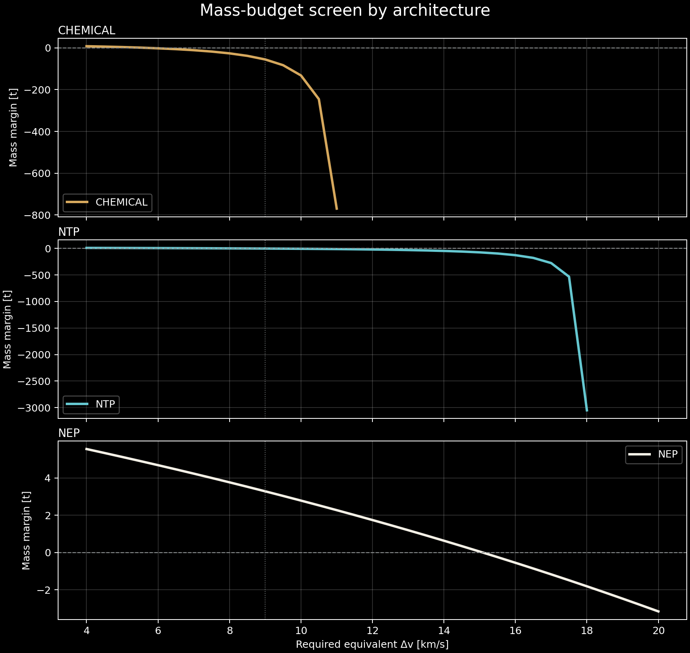
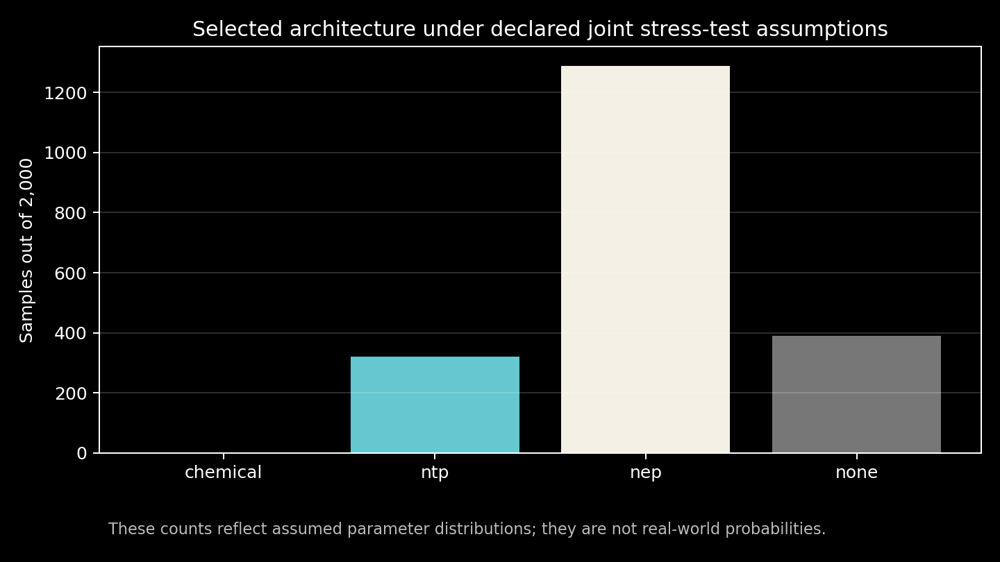
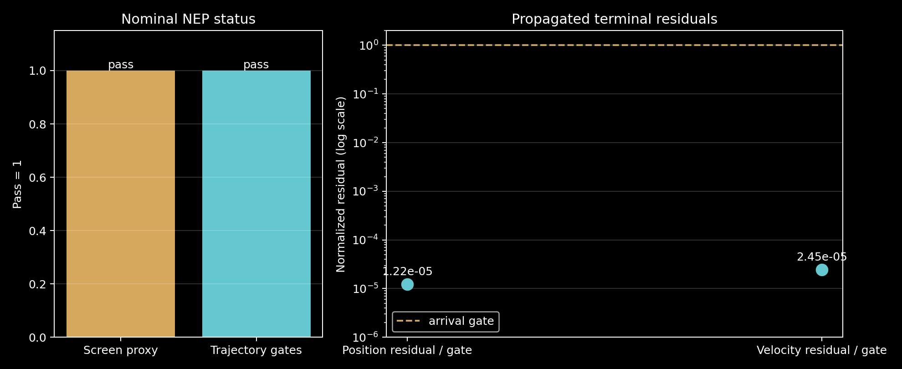
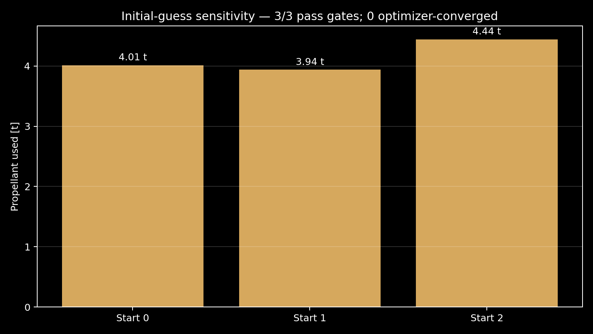

# Midnight Propulsion Lab

**The Crossover Problem — a reproducible study of when nuclear propulsion can make sense for a deep-space mission.**

I started with a practical question: if nuclear-electric propulsion uses propellant efficiently, can that benefit outweigh the mass of its reactor, power-conversion equipment, thrusters, and radiators? This repository turns that question into equations, code, experiments, and plots that another person can reproduce.

This is an independent computational research project, not a claim that nuclear propulsion is always better. It does not introduce a verified new propulsion principle, and it is not flight-design software.

## What the current model says

The first screening scenario assumes a **20,000 kg initial spacecraft**, a **2,000 kg payload**, **9 km/s of equivalent delta-v**, **365 days**, and a **5% propellant reserve**. These are generic modeling inputs, not a specified real mission.

| Architecture | Calculated initial-mass margin | Result in this screening model |
|---|---:|---|
| Chemical | −55.42 t | Exceeds the initial mass budget |
| Nuclear thermal (NTP) | −1.72 t | Exceeds the initial mass budget |
| Nuclear electric (NEP) | +3.28 t | Passes this screen's mass and acceleration checks |

For the selected NEP assumptions, the model estimates **30.59 N idealized thrust**, a **152 m² radiator area**, and about **912 kg of radiator mass**. The NEP configuration assumes 1 MWe electrical power, 60% thruster efficiency, 25% power-conversion efficiency, 8 kg/kWe for the non-radiator power system, and 6 kg/m² radiator areal density. See [`configs/baseline.yaml`](configs/baseline.yaml) and [`docs/assumptions.md`](docs/assumptions.md).

These results are a first-pass mass-and-thrust screen. In particular, NEP's duration check is a constant-thrust acceleration proxy; **passing it does not establish that a real interplanetary trajectory is feasible**.

### Mass-budget screen

Each architecture has its own panel so the chemical model's very large mass shortfall does not hide the smaller NTP and NEP changes. The vertical scales differ by panel.



### Uncertainty stress test

A seeded test of 2,000 synthetic scenarios selected NEP in 1,288 cases (64.4%), NTP in 321 (16.05%), and no feasible architecture in 391 (19.55%). Chemical propulsion was selected in zero cases under this particular scenario distribution and selection rule.

Those percentages are **not real-world success probabilities**. The distributions are deliberately chosen engineering stress-test assumptions, not measurements fitted to a fleet of missions.



## A separate trajectory experiment

The repository also contains an experimental, planar, circular-orbit, Sun-gravity-only Earth-to-Mars surrogate. Its default 365-day bounded-control run uses about **4.03 tonnes of propellant** and finishes with a **6.12 km position residual** and a **0.0123 m/s velocity residual**.

The arrival gates are intentionally loose: 500,000 km in position and 500 m/s in velocity. The model omits real planetary ephemerides, planetary gravity, Earth escape, Mars capture, launch/insertion systems, and operational constraints. It is therefore **not a validated Mars mission** and does not replace the initial architecture screen.

The multi-start diagnostic is also incomplete: three initial guesses passed the loose terminal gates, but none met the optimizer's convergence criterion within the 40-evaluation budget. Their propellant use must not be interpreted as a range of optimal solutions.





Read [`docs/trajectory_validation.md`](docs/trajectory_validation.md) and [`docs/trajectory_comparison.md`](docs/trajectory_comparison.md) before interpreting this experiment.

## Run it on Windows

Use Python 3.12. Open PowerShell in the repository folder:

```powershell
py -3.12 -m venv .venv
.\.venv\Scripts\Activate.ps1
python -m pip install --upgrade pip
python -m pip install -e ".[dev]"
```

Reproduce the baseline, uncertainty analysis, figures, tests, and compilation checks with one script:

```powershell
.\scripts\reproduce_core.ps1
```

Or run those commands individually:

```powershell
python -m midnight_propulsion_lab.cli run --samples 2000 --seed 20261019
python -m midnight_propulsion_lab.cli figures
python -m pytest -q
```

Run the separate trajectory experiment and figures with:

```powershell
.\scripts\reproduce_trajectory.ps1
```

The packaging and execution audit is documented in [`docs/packaging_audit.md`](docs/packaging_audit.md).

The optional multi-start optimizer is slower and may take several minutes:

```powershell
python -m midnight_propulsion_lab.cli trajectory-multistart --starts 3 --seed 20261019 --max-nfev 40
```

Launch the interactive dashboard:

```powershell
streamlit run app/streamlit_app.py
```

If PowerShell blocks virtual-environment activation, see [the official Python venv documentation](https://docs.python.org/3/library/venv.html) or run the environment's Python executable directly without activation.

## What is in the repository?

- [`src/midnight_propulsion_lab/`](src/midnight_propulsion_lab/) — propulsion equations, mass accounting, uncertainty experiment, trajectory propagation, and command-line interface.
- [`app/streamlit_app.py`](app/streamlit_app.py) — interactive assumption explorer.
- [`configs/`](configs/) — explicit baseline and trajectory settings.
- [`results/`](results/) — generated CSV/JSON outputs from the recorded experiments.
- [`figures/`](figures/) — plots generated from the numerical outputs.
- [`tests/`](tests/) — automated tests for equations, mass accounting, and trajectory propagation.
- [`research/`](research/) — initial literature search, annotated references, prior-art screen, and search limitations.
- [`docs/claims_ledger.md`](docs/claims_ledger.md) — what is supported, what is assumed, and what remains unverified.
- [`PUBLISH_TO_GITHUB.md`](PUBLISH_TO_GITHUB.md) — steps to publish this folder as a GitHub repository.

## Research question and prior work

The project began as a search for a useful comparison between chemical, nuclear-thermal, and nuclear-electric propulsion. The initial search found existing studies that already examine NEP mass, radiator effects, hybrid architectures, and mission optimization. Because of that overlap, the current contribution is a **reproducible screening and uncertainty workflow**, not a claim to have invented nuclear propulsion or discovered a new physical law.

Starting references:

- NASA, [Space Nuclear Propulsion](https://www.nasa.gov/space-technology-mission-directorate/tdm/space-nuclear-propulsion/).
- National Academies, [*Space Nuclear Propulsion for Human Mars Exploration*](https://doi.org/10.17226/25977) (2021).
- NASA NTRS, [Considerations for Radiator Design in Multi-Megawatt Nuclear Electric Propulsion Applications](https://ntrs.nasa.gov/citations/20220017479).
- NASA NTRS, [Nuclear Thermal Propulsion Mars Mission Systems Analysis and Requirements Definition](https://ntrs.nasa.gov/citations/20070031964).
- White, MIT thesis, [Nuclear Electric Propulsion system and mission optimization research](https://dspace.mit.edu/entities/publication/a79fca8d-e6ce-4374-b6c2-0abdc20e55a0).
- Kokan et al. (2025), [NEP mission study](https://doi.org/10.1007/s44205-025-00145-x).

The annotated bibliography records why each source is relevant and cautions where publication date, full-text access, or transferability limits the conclusion. This is an initial literature screen, not an exhaustive systematic review or patentability opinion.

## Limitations

- Equivalent delta-v does not make propulsion trajectories equivalent.
- Many system-level inputs are estimates or deliberately varied assumptions.
- The Monte Carlo inputs are not empirically calibrated probability distributions.
- The trajectory experiment is low-fidelity and currently implements NEP only.
- The multi-start optimizer has not demonstrated robustness or global optimality.
- No independent external review has been performed.
- The results establish neither invention novelty, patentability, flight readiness, safety, nor mission feasibility.

The most useful next step is to improve trajectory optimization and validate it against a documented reference case or an independent tool before making architecture-selection claims.

## License and citation

Released under the MIT License. See [`LICENSE`](LICENSE) and [`CITATION.cff`](CITATION.cff). If you use the code, please cite the repository and retain the limitations alongside any reused results.
